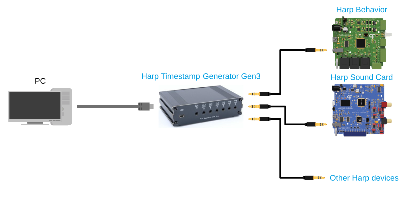

# Harp Timestamp Generator Gen3

The Harp Timestamp Generator Gen3 is a clock synchronization device for the Harp ecosystem. It distributes the Harp timestamp to up to six Harp devices so that their data share a common timeline, can be daisy-chained as a repeater for larger setups, and has an internal battery that keeps the clock running when external power is lost.

## Documentation

The [device documentation](https://harp-tech.org/device.timestampgeneratorgen3) covers the specifications, setting up the device, installing the software, examples for each feature, and the register reference.

## Software

The device can be used from [Bonsai](https://bonsai-rx.org/) through the `Harp.TimestampGeneratorGen3` package, or from Python through the `harp-timestampgeneratorgen3` package. The [installation](https://harp-tech.org/device.timestampgeneratorgen3/articles/installation.html) page describes how to install each of them.

## Repository layout

- `device.yml` describes the registers of the device. The firmware headers and the .NET and Python interfaces are generated from it.
- `firmware` holds the firmware of the device.
- `hardware` holds the PCB and panel design files.
- `software` holds the .NET package for Bonsai and the Python package.
- `docs` holds the documentation site.

## Licensing

Each part of this repository is released under its own license. The `LICENSE` file in each folder states the license that applies to it.
