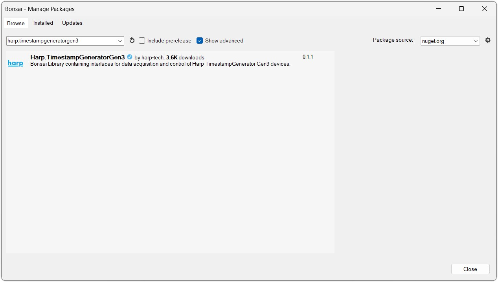
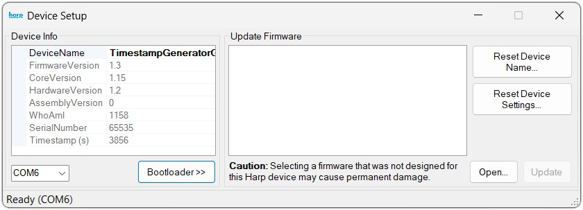

# Installation

This page covers the software you'll need to interact with the Timestamp Generator Gen3, as well as how to update the firmware on the device.

## Software packages

These steps are only required the first time you connect the device to a new computer, and you can install just the packages for the functionality you need.

# [Bonsai](#tab/bonsai)

[Bonsai](https://bonsai-rx.org/) is a visual reactive programming language that provides flexible and comprehensive control of the Timestamp Generator Gen3.

{width=650}

- Download and install [Bonsai](https://bonsai-rx.org/docs/articles/installation.html).
- Launch Bonsai and install the `Harp.TimestampGeneratorGen3` package by searching for it in the [Bonsai package manager](https://bonsai-rx.org/docs/articles/packages.html).
- Install the `Bonsai.StarterPack` package to follow along with the examples in this user guide.

# [Python](#tab/python)

The [Harp](https://harp-tech.org/python/) library provides a Python interface for controlling Harp devices and [loading](logging-analysis.md) recorded data. To install the full library, install it in a Python environment with:

```cmd
pip install harp
```

To install the interface for the Timestamp Generator Gen3:

```cmd
pip install harp-timestampgeneratorgen3
```

To install only the package necessary for loading data:

```cmd
pip install harp-data
```

> [!NOTE]
> Substitute `uv add` for `pip install` if you are using the [uv](https://docs.astral.sh/uv/) package manager.

***

## Firmware update

New features are added and bugs are fixed with firmware updates which are published on the [release page](https://github.com/harp-tech/device.timestampgeneratorgen3/releases) in the device GitHub repository. Each release contains a `.hex` file tagged with the firmware (`fw`) and hardware (`hw`) version. For instance, `TimestampGeneratorGen3-fw1.4-harp1.15-hw1.4-ass0.hex` is firmware v1.4 for a hardware v1.4 Timestamp Generator Gen3. Download the latest firmware version that matches the [hardware version](device.md#hardware) of the device from the "Assets" section under each release.

> [!TIP]
> The hardware version is printed on the front panel of the device (e.g. `harp timestamp generator Gen3 v1.4`).

The firmware can be updated from a terminal with the Harp Toolkit, or from the device setup dialog in Bonsai.

# [Toolkit](#tab/toolkit)

The [Harp Toolkit](https://harp-tech.org/toolkit/) is a command-line tool for working with Harp devices. It is distributed as a .NET tool.

- Download and install the [.NET SDK](https://dotnet.microsoft.com/download), version 8 or later.
- Install the toolkit from a terminal with:

```cmd
dotnet tool install -g Harp.Toolkit
```

- Update the firmware with the serial port of the device and the downloaded `.hex` file:

```cmd
harp.toolkit update --port COM3 TimestampGeneratorGen3-fw1.4-harp1.15-hw1.4-ass0.hex
```

The toolkit checks that the file matches the device before writing it, and waits for the device to restart with the new firmware. Run `harp.toolkit list` to find the serial port of the device. The toolkit [firmware update](https://harp-tech.org/toolkit/articles/update.html) documentation describes every option.

# [Bonsai](#tab/device-setup)

{width=650}

1. Add the [`Device`] operator in Bonsai.
2. Double-click on the [`Device`] node while the workflow is not running.
3. Select the COM port for the device.
4. Click "Bootloader".
5. Click "Open".
6. Select the downloaded `.hex` file.
7. Click "Update".

After the update, the device will reboot with the new firmware and go through the [startup LED sequence](ports-connections.md#front-panel).

***

[!INCLUDE [](../includes/version-footer.md)]

<!--Reference Style Links -->
[`Device`]: xref:Harp.TimestampGeneratorGen3.Device
