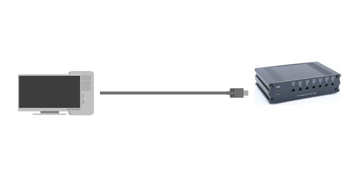
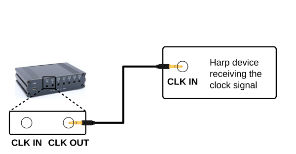
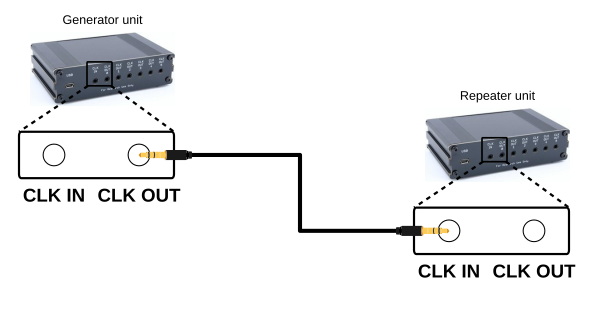

# Ports and connections

This article covers the ports, controls, and status indicators on the Timestamp Generator Gen3, as well as how to connect the device to a computer and to the Harp devices it will synchronize.

## Front panel

{width=600}

**EXPANSION (Box Header)** - Connector reserved for future expansion modules.

**OPTION** - Multi-function button. The executed action depends on how long the button is held before it is released, following the legend printed below it. The status indicators in the LED panel also blink to show which option is being selected.

- **~ 1 s** - Check the battery level.
- **~ 3 s** - Lock or unlock the device clock.
- **~ 6 s** - Toggle between clock generator and repeater mode (see the [Connections](#connections) section). The device reboots into the new mode after the button is released.
- **> 12 s** - Start or stop a [battery maintenance cycle](manage-battery-charging.md#run-battery-cycle) (requires external power).

**BATTERY** - Connects or disconnects the internal battery. With the switch on, the device keeps the clock running when external power is removed. The switch also needs to be on to check the [battery level](./monitor-device-status.md) or for [charging](./manage-battery-charging.md).

**LED PANEL** - At power-up the device runs a short LED animation (each LED lights in sequence twice, then all LEDs blink twice). It then shows the following status indicators:

- **OUT0**–**OUT5** - On when a device is connected to the corresponding clock output port. The LEDs also display:

    - The battery level, shown on the top row for a few seconds after a short press of the **OPTION** button (1 LED = low or **BATTERY** switch off, 2 LEDs = medium, 3 LEDs = high).
    - A running [battery maintenance cycle](manage-battery-charging.md#run-battery-cycle), marked by the top and bottom rows blinking alternately.

- **REPEAT** - On when the device is operating as a clock repeater and off when operating as a clock generator (see the **Generator mode** and **Repeater mode** tabs in the [Connections](#connections) section).

- **LOCK** - On when the device clock is locked and off when it is unlocked.

- **STATE** - The LED cycles on and off with a period of:

    - 2 seconds when it's communicating with Bonsai.
    - 4 seconds when in standby.
    - 100 milliseconds when a catastrophic error occurs.

    If the device has a low battery, the LED also flashes rapidly (5 Hz for 2 seconds) after the startup sequence.

- **ON** - On when the device is running from external (USB) power and off when running from the battery. If the battery becomes depleted (≤ 3.25 V) with no external power, the LED blinks for a couple of seconds and the device turns itself off to protect the battery.

> [!NOTE]
> When running from the battery, some of the indicator LEDs only flash briefly every few seconds to save power. The panel appearing mostly dark is normal in battery operation.

## Back panel

{width=600}

**USB (USB-C)** - This port connects the device to the computer for communication and also provides the external power used to run the device and charge its internal battery.

**CLK IN (Stereo Jack)** - When the device is configured as a repeater, it receives the Harp clock from an upstream timestamp generator or clock synchronizer on this port instead of generating its own.

**CLK OUT (Stereo Jack)** - These ports distribute the Harp synchronization clock to up to 6 Harp devices. Connect each port to the clock input (**CLK IN**) port of a Harp device. The device automatically detects which ports have a device connected, reported by the corresponding **OUT** LED on the front panel.

## Connections

The Timestamp Generator Gen3 can be used in one of two modes, generator or repeater, depending on the number of units and connected devices. In either mode, the device is also compatible with other Harp timestamp generators and clock synchronizers.

# [Power and PC](#tab/powerandpc)

{width=600}

1. Connect the **USB** port to the computer with a USB-C cable. The cable powers the device, charges its battery, and carries the communication with Bonsai.

# [Generator mode](#tab/generatormode)

{width=600}

For synchronization of up to 6 Harp devices:

1. Set the device to generator mode (the default). To toggle the mode, hold the [OPTION](#front-panel) button for about 6 seconds. The **REPEAT** LED is off in generator mode.
2. Connect each **CLK OUT** port to the clock input port of a Harp device with a stereo jack cable.
3. Refer to the [Set clock](set-clock.md) article to set the clock of every connected device from Bonsai.

# [Repeater mode](#tab/repeatermode)

{width=600}

For synchronization of more than 6 Harp devices:

1. Connect every additional Timestamp Generator Gen3 unit to the computer over USB for communication and power.
2. Set one unit to generator mode (the default).
3. Connect a **CLK OUT** port of the generator unit to the **CLK IN** port of each of the other units with a stereo jack cable.
4. Set each of the other units to repeater mode by holding its [OPTION](#front-panel) button for about 6 seconds. The **REPEAT** LED is on in repeater mode.
5. Connect each **CLK OUT** port of every unit to the clock input port of a Harp device with a stereo jack cable.
6. Refer to the [Set clock](set-clock.md) article to set the clock of every connected device from Bonsai.

---

[!INCLUDE ]
