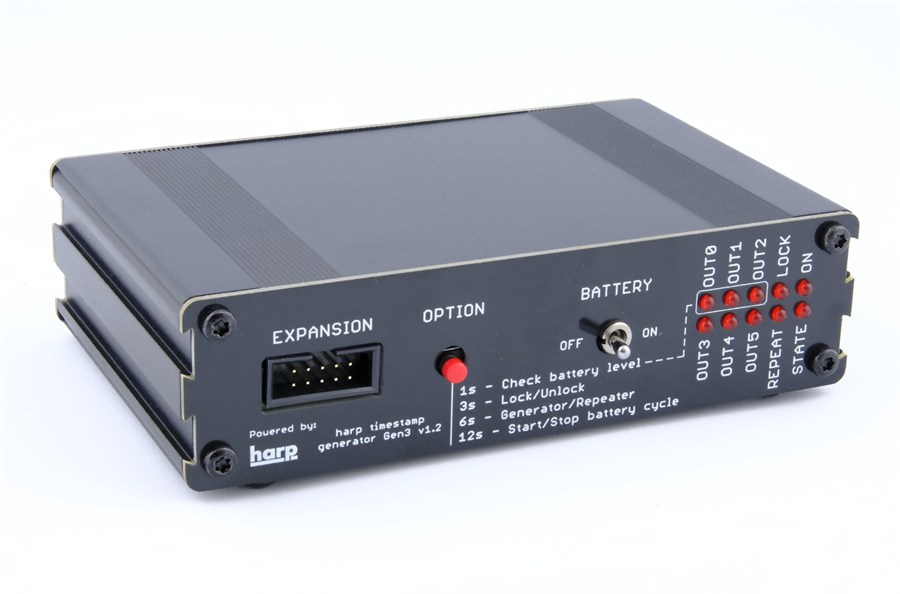

# Timestamp Generator Gen3

{width=450}

## Key features

- Distributes the Harp synchronization clock to up to 6 Harp devices.
- Operates as a clock generator (the default) or as a clock repeater that re-distributes an incoming clock, allowing several units to be daisy-chained in larger setups.
- Internal battery to prevent clock interruption during power outages.
- Programmable clock start time, with a lock to avoid resetting the clock by mistake.
- LED indicators for connected devices, battery level, and device status.

## Specs

- Clock inputs: 1
- Clock outputs: 6
- Timestamp resolution: 32 µs
- Synchronization frequency: 1 Hz
- Synchronization accuracy: 22 ± 16 µs
- Battery capacity: 2 Ah (lithium polymer)
- Battery runtime: up to 24 h
- Battery default charging thresholds: 3.7–3.8 V ([configurable](manage-battery-charging.md))
- Battery charging safety limits: 3.6–4.1 V (charging starts or stops automatically when the battery reaches these limits, regardless of the configured thresholds)
- Battery depleted limit: 3.5 V (the battery protection circuit shuts the device down, or keeps it from starting up, without external power)

## Hardware

| Version | Notes |
| ------- | ----- |
| 1.4 | <ul><li> Added a battery protection circuit that shuts the device down when the battery drops below 3.5 V </li></ul> |
| 1.3 | <ul><li> Changed the USB Mini-B connector to USB-C </li></ul> |
| 1.2 | <ul><li> Initial version </li></ul> |

## Firmware

| Version | Notes |
| ------- | ----- |
| 1.4 | <ul><li> Suspended the serial port while the device runs without USB power </li><li> Raised the battery voltage thresholds </li></ul> |
| 1.3 | <ul><li> Raised the Harp core to 1.15 </li></ul> |
| 1.2 | <ul><li> Added a unitary periodic counter </li><li> Implemented and exposed the connected devices register in `device.yml` </li></ul> |
| 1.1 | <ul><li> Added a prototype device schema and interface </li><li> Fixed the charge/discharge stop command </li><li> Updated the interface to use the new generators </li><li> Raised the Harp core to 1.13 </li></ul> |
| 1.0 | <ul><li> Initial version </li></ul> |

[!INCLUDE ]
