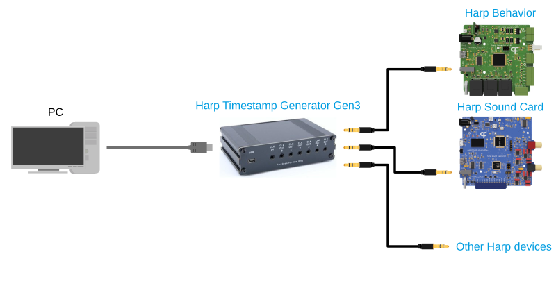

# Overview

The Harp [Timestamp Generator Gen3](articles/timestampgeneratorgen3.md) is a clock synchronization device for the [Harp ecosystem](https://harp-tech.org/articles/about.html).

Behavioral rigs often include multiple Harp devices that acquire data simultaneously. Since each Harp device timestamps data using an onboard clock, their individual clocks must be synchronized. The Timestamp Generator Gen3 uses its onboard clock to generate and distribute the current Harp timestamp to every connected Harp device, allowing them to continuously synchronize their onboard clocks. As a result, data streams acquired across the entire rig are timestamped on a common timeline in real time and do not require any post-hoc alignment.

The Timestamp Generator Gen3 provides:

- Synchronization of up to six Harp devices from a single unit, with the option to daisy-chain additional units as repeaters for larger systems.
- A common timeline for Harp devices connected to different acquisition computers, enabling distributed experimental setups.
- An internal battery that keeps the clock running when external power is lost, so data acquired before and after an interruption remain on the same timeline. This is particularly useful for long-term experiments spanning multiple days.
- [Bonsai](https://bonsai-rx.org/) integration for flexible experiment acquisition and control.

## Getting a device

Assembled units are available from the [Open Ephys store](https://open-ephys.org/harp), or build your own using the hardware design files in the [Timestamp Generator Gen3](https://github.com/harp-tech/device.timestampgeneratorgen3) repository. Once you have a device, follow the "Getting started" section to [set up the device](./articles/ports-connections.md) and install the [software](./articles/installation.md).

## Acknowledgments

Hardware design contributed by [Champalimaud Foundation](https://www.cf-hw.org/), Bonsai interface by [NeuroGEARS](https://neurogears.org/), testing and feedback by [Allen Institute for Neural Dynamics](https://www.allenneuraldynamics.org/), and documentation by [Open Ephys](https://open-ephys.org/).

[!INCLUDE ]
